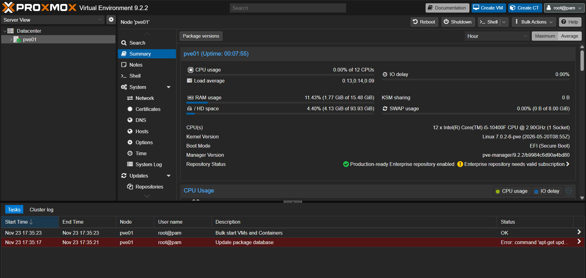
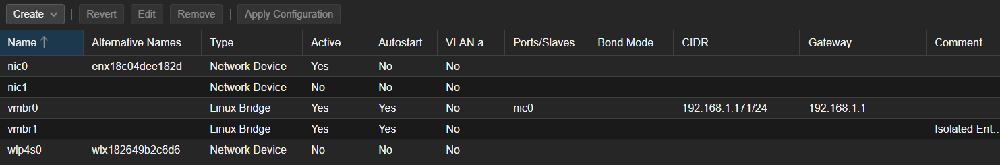
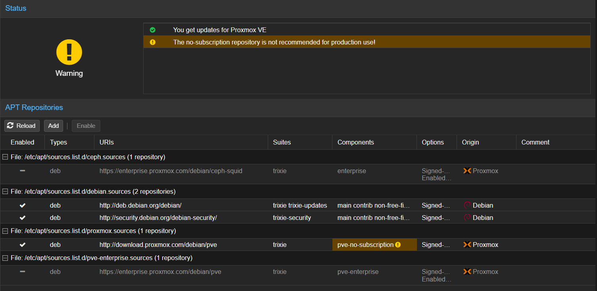

# 01 — Proxmox VE Setup

## Objective
Deploy Proxmox VE on a repurposed desktop PC to host
a virtual enterprise IT environment.

## Hardware
- CPU: Intel Core i5-10400F
- RAM: 16 GB
- Storage: SSD
- Hypervisor: Proxmox VE 9.2.2

Storage Verification: Verified that Proxmox's LVM-Thin storage pool provides 374.54 GB of capacity. Selected thin-provisioned virtual disks to improve storage efficiency and accommodate multiple virtual machines.

## Completed Tasks
- [x] Installed Proxmox VE
- [x] Configured management networking
- [x] Configured software repositories and updates
- [x] Created isolated Linux bridge vmbr1

## Next Steps
- Upload Windows Server 2025 ISO
- Create the first virtual machine (DC01)

## Configuration Screenshots

### Proxmox Dashboard

### Virtual Network Configuration

### Software Repositories

