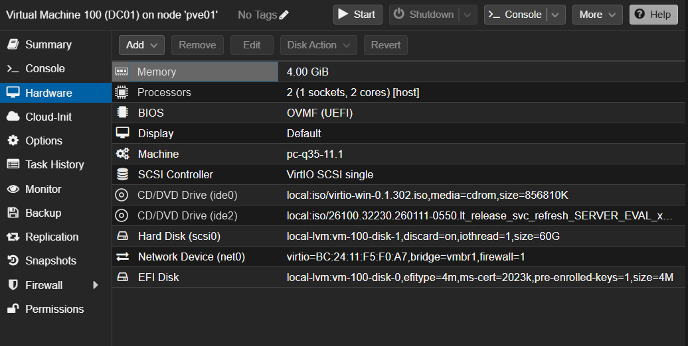
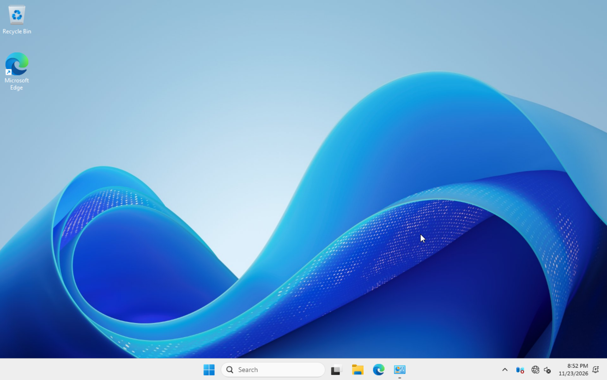
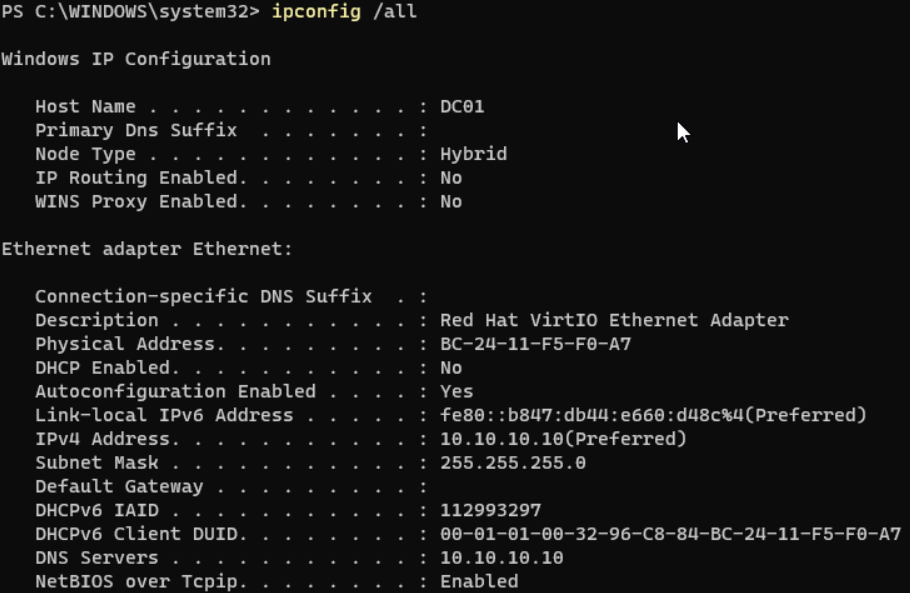

# 02 — Windows Server 2025 Deployment

## Objective

Deploy a Windows Server 2025 virtual machine within Proxmox VE to serve as the foundation for a simulated small-business Active Directory environment.

The server, named `DC01`, will eventually host Active Directory Domain Services (AD DS), DNS, DHCP and Group Policy.

## Virtual Machine Configuration

| Component | Configuration |
|---|---|
| Hypervisor | Proxmox VE |
| VM ID | 100 |
| Hostname | DC01 |
| Operating System | Windows Server 2025 |
| CPU | 2 vCPU |
| Memory | 4 GB |
| Virtual disk | 60 GB |
| Disk controller | VirtIO SCSI |
| Firmware | OVMF (UEFI) |
| Machine type | q35 |
| Network adapter | VirtIO |
| Network bridge | vmbr1 (isolated) |

## Installation and Configuration

### 1. Virtual Machine Creation

Created VM 100 in Proxmox VE with the hardware specifications listed above.

Attached the Windows Server 2025 installation ISO and VirtIO driver ISO as virtual CD/DVD drives.

The VM was connected to the isolated `vmbr1` Linux bridge to keep its future enterprise network services separate from the household network.

### 2. Windows Server Installation

Installed Windows Server 2025 using the graphical Desktop Experience.

During installation, Windows Setup did not initially detect the virtual hard disk.

**Issue:** Virtual storage disk not detected.

**Cause:** Windows Setup did not have the required VirtIO SCSI storage controller driver loaded.

**Resolution:**
1. Selected the Load Driver option in Windows Setup.
2. Navigated to the VirtIO driver ISO.
3. Loaded the Windows Server 2025 VirtIO SCSI driver from `vioscsi/2k25/amd64`.
4. Confirmed that the virtual hard disk became available.
5. Continued with the Windows Server installation.

**Verification:** Windows successfully installed onto the virtual disk.

### 3. VirtIO Guest Tools

Installed the VirtIO Guest Tools and confirmed that the QEMU Guest Agent was installed.

These tools provide improved virtual hardware support and allow better communication between the Windows guest and Proxmox.

### 4. Computer Name Configuration

Renamed the Windows Server computer to `DC01` and restarted the VM to apply the change.

The hostname follows a naming convention identifying the machine as the planned first domain controller.

### 5. Static IP Configuration

Configured a static IPv4 address for the server.

| Setting | Value |
|---|---|
| IPv4 address | 10.10.10.10 |
| Subnet mask | 255.255.255.0 |
| Default gateway | Not configured |
| Preferred DNS | 10.10.10.10 |
| Alternate DNS | Not configured |

The server is connected to the isolated `10.10.10.0/24` enterprise network through Proxmox's `vmbr1` bridge.

The default gateway was left blank because the isolated network does not currently have a router.

DC01 is configured to use its own address for DNS in preparation for the installation of the DNS Server role alongside Active Directory.

**Verification:** Used `ipconfig /all` to confirm that the assigned network settings were applied correctly.

## Screenshots

## Skills Developed

- Virtual machine provisioning and configuration.
- Installation of Windows Server.
- Virtual hardware and VirtIO driver management.
- Troubleshooting missing storage controller drivers.
- Windows Server hostname configuration.
- Static IPv4 addressing and subnet masks.
- Virtual network isolation.
- Basic Windows Server administration.

## Current Status

**Windows Server deployment completed.**

Active Directory Domain Services has not yet been installed.

## Next Steps

- [ ] Install Active Directory Domain Services.
- [ ] Configure DNS Server.
- [ ] Promote DC01 to a domain controller.
- [ ] Create the `ad.apex.test` domain.
- [ ] Verify Active Directory and DNS functionality.

