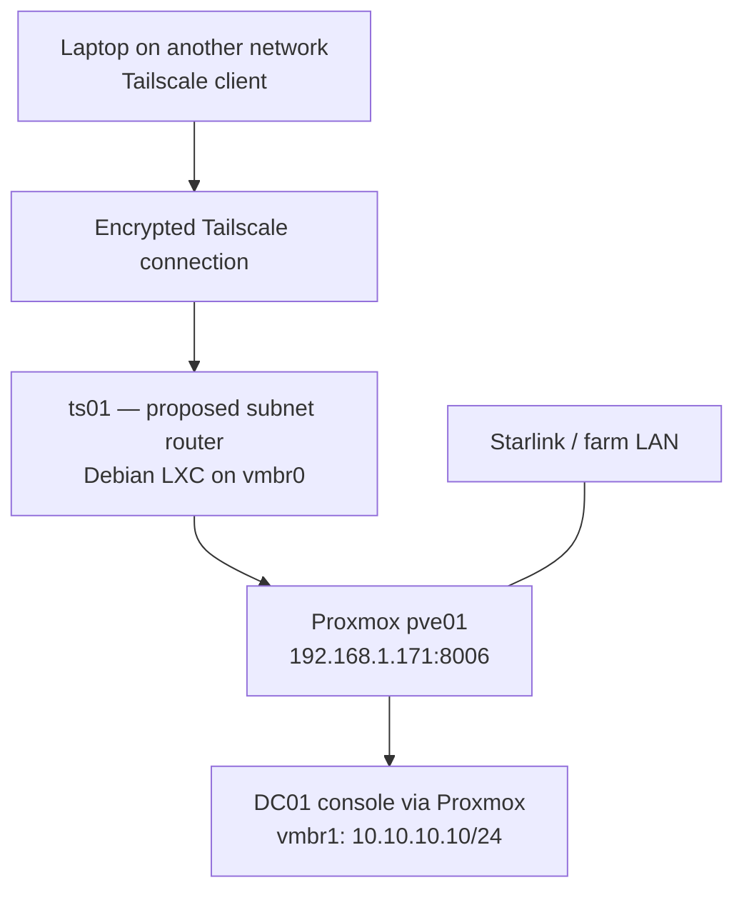

# 04 — Secure Remote Access with Tailscale

## Objective

Enable secure administration of the Proxmox homelab while away from the farm's Starlink network, without exposing the Proxmox web interface directly to the public internet.

This is an independent learning exercise covering Linux containers, VPN connectivity, IP routing, and remote infrastructure management.

## Environment and architecture

| Component | Configuration |
| --- | --- |
| Hypervisor | Proxmox VE 9.2.2, node `pve01` |
| Proxmox management | `192.168.1.171:8006` on `vmbr0` (address specific to the current farm network) |
| Internet connection | Starlink |
| Enterprise lab bridge | `vmbr1`, isolated from the physical LAN |
| Windows Server | `DC01`, `10.10.10.10/24` on `vmbr1` |
| Remote access software | Tailscale |
| Proposed gateway | Debian LXC container `ts01`, CT ID `101`, attached to `vmbr0` |

> **Evidence note:** The operator confirmed successfully loading the Proxmox web UI on a laptop while connected to a phone's mobile hotspot rather than the farm's Starlink network. The exact live container settings, advertised routes, and access policies have not yet been independently inspected. Entries below distinguish the intended design from the confirmed result.



The remote client uses the Proxmox **web console** to work with DC01. That does not require routing Tailscale traffic directly into the isolated Active Directory network.

## Design decisions and why they matter

### Dedicated container rather than modifying the hypervisor

The proposed setup runs Tailscale inside a lightweight, **unprivileged** Linux container. This separates the VPN software from the Proxmox host and provides useful hands-on experience with Linux service administration. LXC device passthrough and forwarding permissions must be configured correctly for this design.

### Separate management and enterprise lab networks

- `vmbr0` connects Proxmox management to the farm's physical LAN.
- `vmbr1` is the isolated virtual switch for the Windows enterprise environment.

Keeping the bridges separate avoids accidentally exposing the lab's future DHCP traffic to the household network.

### Limit the advertised route

The intended subnet-router advertisement is:

```bash
tailscale set --advertise-routes=192.168.1.171/32
```

A `/32` route targets **only the Proxmox management IP**, rather than advertising the entire farm LAN (`192.168.1.0/24`). The route must be approved in the Tailscale admin console, accepted by the client where required, and permitted by appropriate access rules.

> A narrow advertised route is not the same as an access-control policy. Review the tailnet's grants/ACLs to ensure only authorised devices/users can reach the host, ideally limited to TCP port `8006`. A default allow-all rule can defeat the intended restriction.

## Implementation record

The following were the planned stages of deployment. Mark each as verified against the actual system:

- [ ] Confirm `ts01` exists and is attached to `vmbr0`.
- [ ] Confirm the container is unprivileged and `/dev/net/tun` is available.
- [ ] Confirm Tailscale is installed and its service is running inside `ts01`.
- [ ] Confirm the administration laptop and `ts01` are in the same tailnet.
- [ ] Confirm IPv4 forwarding is enabled as needed for subnet routing.
- [ ] Confirm `192.168.1.171/32` is advertised and approved.
- [ ] Review access policies and verify they restrict who can reach Proxmox.
- [ ] Enable automatic startup of the container.
- [x] Test from a **different** network (phone hotspot): Proxmox UI reached successfully, as confirmed by the operator.

### Useful verification commands

Inside `ts01` (if using the container architecture):

```bash
ip -4 addr
ip route
ls -l /dev/net/tun
systemctl status tailscaled
tailscale status
sysctl net.ipv4.ip_forward
ping -c 3 192.168.1.171
```

On a Linux administration laptop (if applicable):

```bash
tailscale status
ip route get 192.168.1.171
```

These are diagnostic commands; inspect their output rather than assuming any particular result.

## Reported troubleshooting incident

**Symptom:** While testing Proxmox access, the browser displayed *“Site can't be reached.”*

**Result:** Access was subsequently reported working.

**Root cause and actual corrective action:** Not yet recorded. Possible troubleshooting areas include local connectivity, Tailscale device status, approved routes, client route acceptance, and access policies. Do **not** describe any of these possibilities as the confirmed cause until tested.

## Verification status

| Check | Status |
| --- | --- |
| Proxmox web interface can be reached | Reported working |
| VPN works from outside Starlink Wi-Fi | **Passed — operator accessed Proxmox UI from phone hotspot** |
| Route approval and scope | Not yet documented |
| Tailscale policy restrictions | Not yet documented |
| Automatic startup after host reboot | Not yet documented |

**Completed off-network acceptance test (reported):** The operator connected the laptop through a phone hotspot instead of the farm's Starlink Wi-Fi and could still reach the Proxmox web UI. This confirms off-LAN web access in that test. Login functionality and the DC01 console were not separately reported as tested on the hotspot. Do not forward port 8006 publicly.

## Screenshots to add

Upload screenshots **from the real setup** into `screenshots/` and then link them here:

1. `tailscale-container.png` — Proxmox container configuration (avoid credentials).
2. `tailscale-devices.png` — Tailscale machines and approved route (hide account/device identifiers as appropriate).
3. `remote-access-test.png` — Proxmox web interface reached from a different network.

No screenshots have been added to this section yet.

## Security and operational notes

- Use Tailscale authentication and MFA, and restrict membership to authorised people.
- Never forward the Proxmox management port directly from the Starlink router to the internet.
- Avoid publishing auth keys, API tokens, recovery codes, or sensitive configuration exports.
- Protect the Proxmox account with a strong password and suitable authentication safeguards.
- If the host changes physical networks, its management IP and advertised route may need to change.
- A remote-access container cannot recover a completely offline host or a broken physical management network; retain a local recovery method.

## Skills practised

Linux containers, VPN administration, private IP addressing, host routes, network segmentation, service troubleshooting, and documenting unresolved verification tasks.

## Next steps

- [ ] Record the precise configuration actually deployed.
- [x] Verify that Proxmox UI is reachable from another network (phone hotspot).
- [ ] Review access restrictions and persistent service startup.
- [ ] Add authentic screenshots and a short test log.

---

*Part of the [Enterprise IT Homelab](../README.md).*
