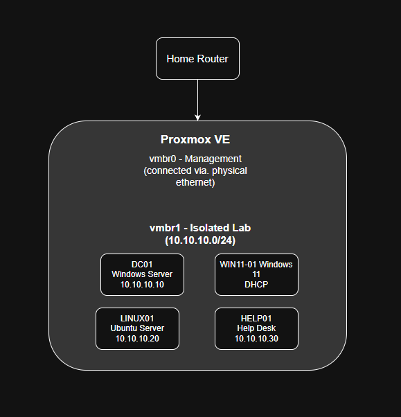

# Enterprise IT Homelab

## Project Overview

This repository documents the planning, deployment, configuration, and management of a virtualised small-business IT environment using Proxmox Virtual Environment (VE).

The purpose of this project is to develop practical, hands-on experience with enterprise IT infrastructure, including Windows Server administration, Active Directory, networking, virtualisation, Linux, cybersecurity, and IT troubleshooting.

The homelab will simulate the infrastructure of a fictional small business, providing opportunities to configure, manage, secure, and troubleshoot systems commonly encountered in real-world IT environments.

This project is being developed independently during my university break to strengthen my technical knowledge and prepare for entry-level IT support, systems administration, and infrastructure roles.

## Project Objectives

The main objectives of this homelab are to:

- Gain practical experience deploying and managing virtual machines.
- Configure and administer a Windows Server environment.
- Implement Active Directory Domain Services (AD DS), DNS, DHCP, and Group Policy.
- Manage user accounts, security groups, and permissions.
- Develop PowerShell scripting and automation skills.
- Configure and troubleshoot virtual networks.
- Gain experience administering Linux servers.
- Deploy and maintain self-hosted services.
- Practise identifying, diagnosing, and resolving common IT issues.
- Develop technical documentation and troubleshooting skills.

## Hardware and Software

### Physical Hardware

| Component | Specification |
|---|---|
| Server | Repurposed desktop PC |
| Processor | Intel Core i5-10400 (6 cores / 12 threads) |
| Memory | 16 GB RAM |
| Storage | SSD |
| Hypervisor | Proxmox VE 9.2.2 (deployed) |
| Management workstation | Main PC running Windows and Ubuntu |

### Planned Virtual Infrastructure

| System | Purpose |
|---|---|
| Windows Server 2025 | Active Directory, DNS, DHCP and Group Policy |
| Windows 11 | Domain-joined employee workstation |
| Ubuntu Server | Linux administration and network services |
| Pi-hole | Network-wide DNS filtering |
| Help-desk system | Simulated IT support and ticket management |
| Network monitoring tools | Service availability and troubleshooting |
| OPNsense | Firewall and network segmentation |

*The infrastructure will be deployed progressively, with resource allocations adjusted to accommodate the available hardware.*

## Proposed Network Architecture

The homelab will use separate virtual networks to isolate the simulated business infrastructure from the existing home network.

- `vmbr0` connects to the physical Ethernet interface.
- `vmbr1` is an isolated virtual bridge with no physical interface attached.

### Proposed Network Configuration

| Network | Purpose | Addressing |
|---|---|---|
| Management Network (`vmbr0`) | Proxmox administration and farm LAN connectivity | `192.168.1.171/24` (current location) |
| Enterprise Lab (`vmbr1`) | Isolated business infrastructure | `10.10.10.0/24` |

### Planned Enterprise Systems

| Hostname | Role | Planned IP |
|---|---|---|
| DC01 | Windows Server / Domain Controller | `10.10.10.10` |
| WIN11-01 | Employee workstation | DHCP assigned |
| LINUX01 | Ubuntu Server | `10.10.10.20` |
| HELP01 | Help-desk server | `10.10.10.30` |

The network will be designed to support safe testing of enterprise services without interfering with the household network.

*The diagram shows the planned infrastructure. The Proxmox host, `vmbr1`, and `DC01` have since been deployed; other VMs are planned.*

## Project Roadmap

### Phase 1 — Proxmox and Virtualisation

- [x] Install Proxmox VE on the dedicated server.
- [x] Configure Proxmox management access.
- [x] Configure virtual bridges and isolated networking.
- [x] Create and configure the initial Windows Server VM (`DC01`).
- [ ] Learn VM snapshots, storage, and resource management.

### Phase 2 — Windows Server and Active Directory

- [x] Install Windows Server 2025.
- [x] Install AD DS and promote `DC01` for `ad.apex.test`.
- [x] Configure and verify Active Directory DNS (A, PTR, and SRV records).
- [ ] Configure DHCP for the isolated lab.
- [ ] Create organisational units for fictional departments.
- [ ] Create and manage users, computers, and security groups.
- [ ] Join Windows 11 to the domain.
- [ ] Configure and test Group Policy Objects (GPOs).

### Phase 3 — Systems Administration and Automation

- [ ] Configure shared folders and NTFS permissions.
- [ ] Implement role-based access controls.
- [ ] Develop PowerShell scripts for user management.
- [ ] Automate common administrative tasks.
- [ ] Practise onboarding and offboarding employees.

### Phase 4 — Networking and Security

- [ ] Configure virtual networks and firewall rules.
- [ ] Perform connectivity and DNS troubleshooting.
- [ ] Capture and analyse network traffic using Wireshark.
- [ ] Explore network segmentation.
- [ ] Investigate common authentication and connectivity issues.

### Phase 5 — Self-Hosted Services

- [ ] Deploy Pi-hole for DNS filtering.
- [ ] Configure service availability monitoring.
- [ ] Deploy an IT help-desk/ticketing platform.
- [ ] Explore additional Linux-based services.

### Phase 6 — Troubleshooting and Documentation

- [ ] Simulate common IT support issues.
- [ ] Document troubleshooting procedures and resolutions.
- [ ] Create technical knowledge-base articles.
- [ ] Document infrastructure configuration and security decisions.
- [ ] Review and improve the overall environment.

## Documentation

Each major stage of the project will include documentation covering:

1. **Objective:** What the task aims to accomplish.
2. **Implementation:** Configuration steps, commands, and tools used.
3. **Evidence:** Screenshots, diagrams, and configuration examples.
4. **Troubleshooting:** Problems encountered, investigation, and resolution.
5. **Verification:** How successful operation was confirmed.
6. **Lessons Learned:** Technical knowledge and skills gained.

Documentation will be added progressively as the project develops.

## Technologies and Skills

The project is intended to develop experience with the following technologies:

**Virtualisation:** Proxmox VE, virtual machines, Linux containers

**Windows Infrastructure:** Windows Server, Active Directory, DNS, DHCP, Group Policy, NTFS permissions

**Networking:** TCP/IP, subnetting, routing, virtual switches, firewalls, Wireshark

**Linux:** Ubuntu Server, command-line administration, SSH, system services

**Automation:** PowerShell, Bash scripting

**IT Operations:** Troubleshooting, monitoring, help-desk ticketing, technical documentation

**Security:** Access control, network segmentation, authentication, system monitoring

## Project Documentation

- [01 — Proxmox Setup](01-proxmox-setup/README.md)
- [02 — Windows Server Deployment](02-windows-server/README.md)
- [03 — Active Directory and DNS](03-active-directory/README.md)
- [04 — Tailscale Remote Access](04-remote-access-tailscale/README.md)

## Current Project Status

**Status:** Active development — Proxmox and DC01 deployed.

- Proxmox VE installed with isolated `vmbr1` network.
- Windows Server 2025 VM `DC01` configured at `10.10.10.10/24`.
- Active Directory forest/domain `ad.apex.test` created; basic DNS and SRV checks passed.
- Tailscale-based access to Proxmox reported working. Off-network routing/security verification is documented as pending in the remote-access project.

**Next:** Build organisational units, users, groups and client join testing. The Windows Server evaluation's activation and security updates also require planned controlled internet access.

## Future Improvements

Potential future expansions include:

- More advanced network segmentation and firewall configurations.
- Centralised monitoring and logging.
- Automated backup and recovery procedures.
- Additional Windows and Linux servers.
- Further PowerShell and Bash automation.
- Further restrictions and verification for Tailscale remote administration.

## Disclaimer

This homelab is an independent educational project built using personal hardware and evaluation software where applicable.

All business environments, accounts, and scenarios are fictional. Configuration examples and screenshots will be reviewed to avoid exposing credentials or sensitive information.

---

*This repository will be updated throughout the project to document progress, technical challenges, and skills developed.*
